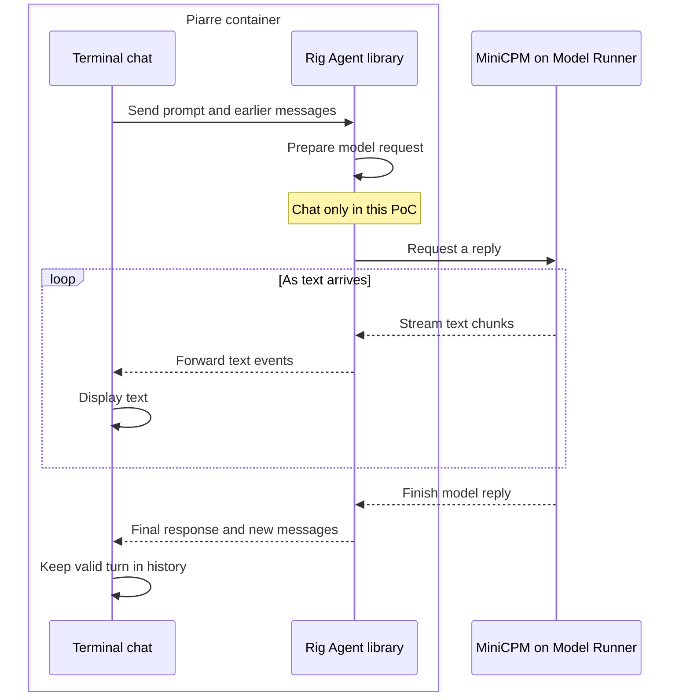

# Piarre

Piarre is a local-model proof of concept for chatting with MiniCPM5-2B in a disposable Docker container. It uses a Rust Rig harness. File tools and thinking display are planned.

## Set up

Start Docker Desktop with Model Runner enabled. The current setup has been verified on an Apple Silicon Mac. You do not need a local Rust installation.

Clone the repository and enter it:

```sh
git clone https://github.com/sysung/piarre.git
cd piarre
```

Install the model once. Allow about 1.56 GB for the model, plus temporary staging space:

```sh
sh scripts/install-model.sh
```

Skip this step if `piarre/minicpm5:2b-q4_k_m` is already installed. The installer removes temporary downloads after success, failure, or interruption. The imported model stays in Docker Model Runner.

## Chat interactively

```sh
docker compose build harness
docker compose run --rm harness
```

Type at `You>`. Press Ctrl-C during a reply to stop local streaming, or Ctrl-D at an empty prompt to exit. Each session starts with fresh history.

To select the disposable workspace for a session:

```sh
docker compose run --rm harness --workspace /workspace
```

You can also select an existing subfolder by its absolute path inside the container. This release validates the directory at startup. [Issue #214](https://github.com/sysung/piarre/issues/214) tracks connecting it to model file tools.

## Release model memory

To release model memory after use:

```sh
docker model unload piarre/minicpm5:2b-q4_k_m
```

## How a chat turn works



With tools registered, Rig can run a tool the model requests, send back the result, and ask the model to continue. Exploration, edits, and verification would be steps in a coding workflow built on that loop. See the [Rig Agent evaluation](openspec/changes/local-model-chat-poc/rig-agent-evaluation.md) for the tool-call test.

## Runtime behavior and limits

Rig runs inside Docker, while Docker Model Runner serves MiniCPM5-2B separately. No personal folders are mounted into the harness.

The harness does not set an output-token cap or generation deadline. It uses the configured model and runtime defaults. Runtime context and output limits still apply. A runtime-reported cutoff is shown as incomplete.

Ctrl-C leaves the interrupted turn out of history. The model server may continue generating after local cancellation.

Terminal control characters appear as visible escapes instead of being executed. Normal text, tabs, and line breaks are preserved.

## Model limitations

In the recorded trials, models sometimes refused harmless requests, contradicted supplied context, or answered recall questions incorrectly. MiniCPM5-2B is the default, but successful examples do not guarantee reliable recall. Check answers against the information you supplied.

See [model observations](openspec/changes/local-model-chat-poc/model-observations.md) for the tested configurations, failures, and accepted PoC limitations.

## Project work

[Tasks and verification](openspec/changes/local-model-chat-poc/tasks.md) · [GitHub Project](https://github.com/users/sysung/projects/8)
