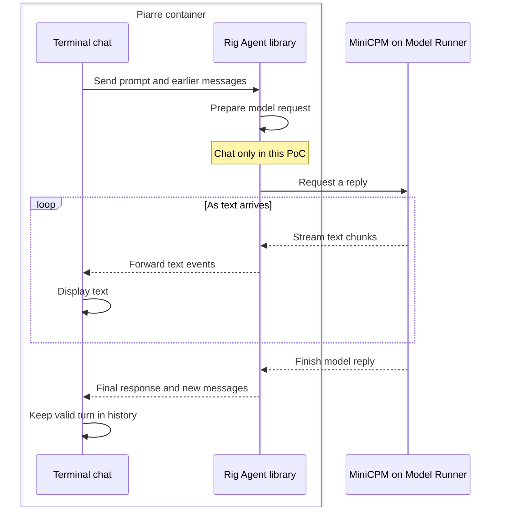

# Piarre

Piarre is a local-model proof of concept for chatting with MiniCPM5-2B in an isolated Docker container. It uses a Rust Rig harness. File tools and thinking display are planned.

## Set up

Start Docker Desktop with Model Runner enabled. The current setup has been verified on an Apple Silicon Mac. You do not need a local Rust installation.

Clone the repository and enter it:

```sh
git clone https://github.com/sysung/piarre.git
cd piarre
```

## Chat interactively

```sh
docker compose run --build --rm harness
```

On first launch, Compose downloads the MiniCPM5-2B Q4_K_M model from Hugging Face (about 1.56 GB) into Docker Model Runner. Later launches use the cached weights.

Type at `You>`. Press Ctrl-C during a reply to stop local streaming, or Ctrl-D at an empty prompt to exit. Each session starts with fresh history.

### Open a project folder

Build the harness from the Piarre checkout:

```sh
docker compose build harness
```

Open your project by replacing `/path/to/project` with its absolute path:

```sh
PIARRE_HOST_WORKSPACE="/path/to/project" docker compose run --rm workspace
```

Your files and edits stay on your machine after chat exits. On Docker setups that require matching host file ownership, pass `--user UID:GID` before `workspace` using your non-root user and group IDs. [#214](https://github.com/sysung/piarre/issues/214) connects Rig's list and read tools to the selected folder.

## Release model memory

To release model memory after use:

```sh
docker model unload hf.co/openbmb/MiniCPM5-2B-GGUF:Q4_K_M
```

## How a chat turn works



With tools registered, Rig can run a tool the model requests, send back the result, and ask the model to continue. Exploration, edits, and verification would be steps in a coding workflow built on that loop. See the [Rig Agent evaluation](openspec/changes/local-model-chat-poc/rig-agent-evaluation.md) for the tool-call test.

## Runtime behavior and limits

Rig runs inside Docker, while Docker Model Runner serves MiniCPM5-2B separately. Plain chat starts without a host folder mount.

The harness does not set an output-token cap or generation deadline. It uses the configured model and runtime defaults. Runtime context and output limits still apply. A runtime-reported cutoff is shown as incomplete.

Ctrl-C leaves the interrupted turn out of history. The model server may continue generating after local cancellation.

Rig streams replies directly to the terminal, where control characters in a reply can affect the display. Ordinary chat hides structured reasoning. Piarre escapes control characters in configuration and error messages.

## Model limitations

In the recorded trials, models sometimes refused harmless requests, contradicted supplied context, or answered recall questions incorrectly. MiniCPM5-2B is the default, but successful examples do not guarantee reliable recall. Check answers against the information you supplied.

See [model observations](openspec/changes/local-model-chat-poc/model-observations.md) for the tested configurations, failures, and accepted PoC limitations.

## Project work

[Tasks and verification](openspec/changes/local-model-chat-poc/tasks.md) · [GitHub Project](https://github.com/users/sysung/projects/8) · [Issue workflow](.agents/docs/issue-tracker.md)
