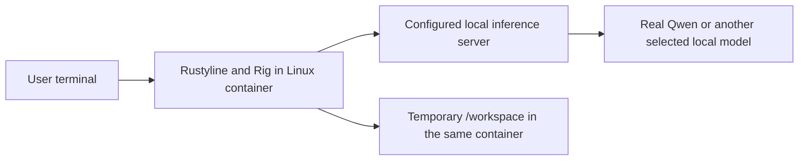

# Design

## Context

The recovery and legacy cleanup are complete. The user approved the smaller real-model-first scope on 2026-11-15. See [proposal](proposal.md). Research is reference material; no model or agent behavior is claimed by these documents.

## Goals / Non-Goals

**Goals:** real Qwen requests, a small Rust/Rig chat application, a user chat trial, and observable file operations inside one disposable Linux container.

**Non-Goals:** benchmarks, strict memory admission, retrieval, model compliance, shell or Python execution, persistent memory, default personal workspace access, public multi-user hosting, authentication infrastructure and a custom model-management service.

## Decisions

### D1. Four milestones with a short delivery path

| Milestone | Value | Observable result |
|---|---|---|
| M0 Preparation and isolation | Agree the experiment and preserve recovery | Updated scope, profile and issue map |
| M1 Running a local model | Establish one working local route | Real model response and actual configuration recorded |
| M2 Creating the agent harness | Try chat and then sample file tasks | Compose Rig chat, human chat trial, bounded file operations |
| M3 User Acceptance Testing | Decide whether to iterate | Human observations, scoped fixes and explicit decision |

Board views and later benchmark work remain tracked independently. No benchmark, evaluator, board automation or 8 GB qualification blocks M1/M2. Completed task IDs remain historical; removed work is recorded as deferred rather than falsely checked off.

### D2. One agent container and a local inference service



Rig is a Rust application, not the inference runtime. Start with existing DMR and its llama.cpp backend. Use a fixed operator-configured local endpoint directly; no mediation proxy initially. The application/image and native inference runtime are trusted local software. This is not a claim that arbitrary compromised container code cannot reach other host APIs or that native inference cannot access Mac files.

No default host mounts, Docker socket, credentials, SSH agent, privileged mode or host networking. Use non-root execution, dropped capabilities, no privilege escalation, read-only application files and bounded writable workspace/temp storage. Inspect the actual mounts and user. Model weights stay in the runtime-managed cache outside the agent. Do not add a LAN listener. Container restrictions do not establish perfect machine isolation.

### D3. Build chat first, then bounded tools

Use one compiled Rust binary, Rig and Rustyline with plain streaming. Compose participates in the first Rig slice. Choose the exact documented launch command during implementation; no Python wrapper is required. Preserve roles and in-session conversation; do not persist prompts by default. Use one active turn, ordinary connection/error handling, safe terminal text and prompt cancellation. Remove the hardcoded 128-output-token override and 120-second deadline; omit output-token overrides and total/read timeouts that stop ongoing generation. Use the configured model/runtime defaults rather than substituting a larger arbitrary maximum. Runtime context capacity is unchanged. Long-output management is future work. Report unknown backend cancellation honestly; do not build a universal server-idle protocol. Do not overlap unresolved local file mutations.

Optional thinking display is a separate M2 slice after answer streaming (#159), tracked in #182. Verify reasoning support against the real Qwen/DMR/Rig route before choosing the exact request fields and event handling. Label emitted reasoning as Thinking and final content as Answer; provide a hide option. Hiding display and disabling reasoning are different operations. Do not fabricate reasoning for unsupported configurations or treat emitted text as a faithful internal trace. Reuse safe streaming for both channels, including split control sequences. Preserve honest partial/limited outcomes. Set defaults during implementation and document the controls and observed effects on response time and output limits in README. No persistent reasoning logs or new tool authority are introduced.

After the user tries chat, add explicit workspace-tool mode with list/read/create/edit/delete. The real model proposes structured calls and Rust handlers execute them. File operations resolve beneath `/workspace`, reject traversal/symlink escapes and non-regular targets, and have file/output/step bounds. No shell, arbitrary HTTP, generated-code execution, workspace-root deletion or recursive directory deletion. Verify files independently of the model's narration. On cancellation, preserve a truthful record of completed operations.

The workspace is container-owned temporary storage, discarded on teardown. A future personal workspace mount or export is a separate opt-in feature. No second client container is necessary for the initial PoC.

### D4. Observe a few models, do not certify them

Start with the published Qwen artifact in [prerequisites](prerequisites.md). Record runtime/model identities and observations manually. Verify an expected download identity before calling it the pinned artifact. Let operators select other installed local models without a whitelist, quality score, exact tokenizer or memory gate. Unsupported format, load failure and tool-call failure are observed technical limits; they do not require a compliance subsystem. Chat may remain useful when tools fail.

Benchmarks, cohorts, context retrieval, exact serving-memory attribution, runtime rankings, common conversion and closed-model comparison are later work. Preserve the existing research without making it a prerequisite. New downloads are deliberate operator actions rather than model-generated instructions.

### D5. GitHub follows the approved scope

Update existing issues and native dependencies without duplicates. Keep milestone/user-story grouping, description, value, short human checks and source links. Each worked issue links to its PR; a PR uses closing references only for completed issue scope. Keep Project status current and human acceptance distinct from merge. Deferred research has no PoC milestone and no dependency path into active delivery. Board configuration remains optional parallel work.

## Verification plan

1. Inspect the actual container user, mounts and writable paths. Expect no personal paths, credentials or Docker control access.
2. Ask the real local model a simple question directly, then through containerized Rig. Record the actual model/runtime and outcome.
3. For #200, follow the [issue verification plan](https://github.com/sysung/piarre/issues/200): inspect actual request/transport defaults, observe real output beyond 128 tokens and 120 seconds when achievable under existing runtime limits, and record missing evidence explicitly. Verify context errors preserve earlier history.
4. Try two chat turns, cancellation, an unavailable endpoint and restart. Expect visible errors, readable text and fresh session state after restart.
5. For #182, observe real streamed Thinking followed by Answer, hide thinking without losing the answer, and check the unavailable-reasoning behavior. Verify safe rendering across chunk boundaries and honest interrupted/limited output. Record observed latency/output-limit effects without a benchmark gate.
6. Have the user try chat before enabling file tools.
7. With real model tool calls, create, inspect, edit, inspect, delete and verify a sample Python file. Check a harmless outside-workspace request is refused and teardown discards the workspace. No Python execution is implied.
8. Record user observations and acceptance separately from code completion. Recheck only behavior affected by fixes.

Real inference is required for end-to-end evidence; no mocked endpoint is planned. Harmless path/permission checks do not need model-generated malicious output. New automated tests or standalone verifiers still require explicit authorization under AGENTS.md; direct command execution and manual observation are sufficient for routine checks.

## Risks / Trade-offs

- Native runtime is trusted local software; no-host-mount tools do not prove native-process filesystem isolation.
- Open model selection does not promise format or tool-protocol compatibility. Try the selected configuration and report what happened.
- File operations can delete disposable sample files. Start with a chat trial, explicit tool mode, visible operations and resettable storage.
- If arbitrary execution or personal workspace access is requested later, revisit the boundary before adding it.

## Migration and approval

The user approved this revised direction and requested Update followed by Apply on 2026-11-15. It supersedes the earlier research-first Arena decisions and pending profile. Keep the completed reset and inventory evidence; do not repeat deletion. Publish revisions through PR #172, reconcile GitHub and continue implementation. The initial user chat trial is still pending and cannot be performed by the assistant.

## Historical reset manifest

The following manifest is retained as historical context. Completion and approval evidence are in [m0-evidence](m0-evidence.md); it is not a new deletion request.

### Original deletion manifest

This manifest contains 149 tracked paths at the inspected baseline. It is for review, not approved deletion. Refresh it against the current base and unrelated work before cleanup. Retain Git history, archived OpenSpec records, agent configuration and this change. Rewrite README, docs/workflow.md and .gitignore separately; do not delete the whole checkout. Historical design prose remains recoverable from the verified source reference.

<details>
<summary>Exact candidate deletion paths</summary>

```text
.audit/backlog-decisions.tsv
.github/designs/64/empty.svg
.github/designs/64/prototype.html
.github/designs/64/review.svg
.github/designs/64/saved.svg
.github/workflows/ci.yml
.nvmrc
.vscode/launch.json
.vscode/settings.json
.vscode/tasks.json
apps/vscode/README.md
apps/vscode/esbuild.mjs
apps/vscode/esbuild.test.mjs
apps/vscode/native/README.md
apps/vscode/native/scoped-publication.py
apps/vscode/native/test-scoped-publication.py
apps/vscode/package.json
apps/vscode/scripts/package.mjs
apps/vscode/scripts/test-package.mjs
apps/vscode/src/candidate-check-runner.ts
apps/vscode/src/candidate-journal.ts
apps/vscode/src/candidate-workspace.ts
apps/vscode/src/codex-account-context.ts
apps/vscode/src/codex-conversation-client.ts
apps/vscode/src/conversation-controller.ts
apps/vscode/src/coordination-actions.ts
apps/vscode/src/coordination-controller.ts
apps/vscode/src/coordination-ui.ts
apps/vscode/src/coordination-view.ts
apps/vscode/src/detail-document.ts
apps/vscode/src/diagnostic-bundle.ts
apps/vscode/src/diagnostic-commands.ts
apps/vscode/src/execution-actions.ts
apps/vscode/src/execution-coordinator.ts
apps/vscode/src/execution-ui.ts
apps/vscode/src/execution-view.ts
apps/vscode/src/extension.ts
apps/vscode/src/file-context.ts
apps/vscode/src/goal-interpreter.ts
apps/vscode/src/knowledge-controller.ts
apps/vscode/src/project-retrieval.ts
apps/vscode/src/recovery-files.ts
apps/vscode/src/recovery-ui.ts
apps/vscode/src/reflection-controller.ts
apps/vscode/src/repository-root.ts
apps/vscode/src/scoped-publication.ts
apps/vscode/src/source-sharing.ts
apps/vscode/src/sqlite-project-repository.ts
apps/vscode/src/storage-boundary.ts
apps/vscode/src/technical-lookup.ts
apps/vscode/src/work-view.ts
apps/vscode/src/workspace-draft.ts
apps/vscode/src/workspace-integration.ts
apps/vscode/src/workspace-path.ts
apps/vscode/src/workspace-shell.ts
apps/vscode/test/fixtures/fake-codex-account-context.mjs
apps/vscode/test/fixtures/fake-codex-conversation.mjs
apps/vscode/test/profile-settings.mjs
apps/vscode/test/run.mjs
apps/vscode/test/suite/activation.test.ts
apps/vscode/test/suite/agent-workspace.test.ts
apps/vscode/test/suite/candidate-check-runner.test.ts
apps/vscode/test/suite/candidate-journal.test.ts
apps/vscode/test/suite/candidate-workspace.test.ts
apps/vscode/test/suite/codex-account-context.test.ts
apps/vscode/test/suite/codex-conversation.test.ts
apps/vscode/test/suite/context.test.ts
apps/vscode/test/suite/conversation-controller.test.ts
apps/vscode/test/suite/coordination-workspace.test.ts
apps/vscode/test/suite/coordination.test.ts
apps/vscode/test/suite/costs.test.ts
apps/vscode/test/suite/detail-host-fixture.ts
apps/vscode/test/suite/detail-identity.test.ts
apps/vscode/test/suite/diagnostic-bundle.test.ts
apps/vscode/test/suite/execution-coordinator.test.ts
apps/vscode/test/suite/execution-forecast.test.ts
apps/vscode/test/suite/execution-patch.test.ts
apps/vscode/test/suite/execution-state.test.ts
apps/vscode/test/suite/execution-view.test.ts
apps/vscode/test/suite/file-context-render.test.ts
apps/vscode/test/suite/file-context.test.ts
apps/vscode/test/suite/forecast-fixture.ts
apps/vscode/test/suite/foundations.test.ts
apps/vscode/test/suite/index.ts
apps/vscode/test/suite/knowledge.test.ts
apps/vscode/test/suite/project-lifetime-vscode.ts
apps/vscode/test/suite/project-lifetime.test.ts
apps/vscode/test/suite/project-retrieval.test.ts
apps/vscode/test/suite/project.test.ts
apps/vscode/test/suite/proposal.test.ts
apps/vscode/test/suite/provider-settings.test.ts
apps/vscode/test/suite/recovery-host.test.ts
apps/vscode/test/suite/recovery.test.ts
apps/vscode/test/suite/reflection.test.ts
apps/vscode/test/suite/result-review-fixture.ts
apps/vscode/test/suite/result-review-vscode.ts
apps/vscode/test/suite/result-review.test.ts
apps/vscode/test/suite/resumption-view.test.ts
apps/vscode/test/suite/resumption.test.ts
apps/vscode/test/suite/scoped-publication.test.ts
apps/vscode/test/suite/untrusted.test.ts
apps/vscode/test/suite/workspace-integration.test.ts
apps/vscode/test/suite/workspace.test.ts
apps/vscode/tsconfig.json
config/vscode-version.mjs
docs/USER_DESIGN_PRINCIPLE.md
docs/overview.md
docs/research/2026-11-07-shared-project-truth.md
eslint.config.mjs
package-lock.json
package.json
packages/core/package.json
packages/core/src/context.ts
packages/core/src/contracts.ts
packages/core/src/conversation.ts
packages/core/src/coordination-contracts.ts
packages/core/src/coordination.ts
packages/core/src/costs.ts
packages/core/src/execution-contracts.ts
packages/core/src/execution-forecast.ts
packages/core/src/execution-patch.ts
packages/core/src/execution.ts
packages/core/src/index.ts
packages/core/src/inspection.ts
packages/core/src/knowledge.ts
packages/core/src/provider-account-context.ts
packages/core/src/recovery.ts
packages/core/src/reflection.ts
packages/core/src/resumption.ts
packages/core/src/supplied-source.ts
packages/core/tsconfig.json
scripts/accept-candidate.mjs
scripts/candidate-profile.mjs
scripts/documentation-sources.mjs
scripts/evaluate-project-retrieval.mjs
scripts/package-candidate.mjs
scripts/release-package.mjs
test/acceptance/catalog.json
test/acceptance/principles.json
test/acceptance/retrieval-fixture.json
test/candidate-profile.test.mjs
test/diagnostic-commands.test.mjs
test/documentation-sources.test.mjs
test/editor-boundary.test.mjs
test/release-package.test.mjs
test/repository-root.test.mjs
test/scaffold-contract.test.mjs
tsconfig.base.json
tsconfig.json
```

</details>

## Research references

- [Docker Model Runner execution and API exposure](https://docs.docker.com/ai/model-runner/)
- [Compose model lifecycle](https://docs.docker.com/ai/compose/models-and-compose/)
- [Ollama platform behavior](https://docs.ollama.com/faq)
- [Rig](https://github.com/0xPlaygrounds/rig) and [Rustyline](https://docs.rs/rustyline/latest/rustyline/)
- [LiveCodeBench](https://livecodebench.github.io/)

These references support research choices; they do not establish local qualification.
