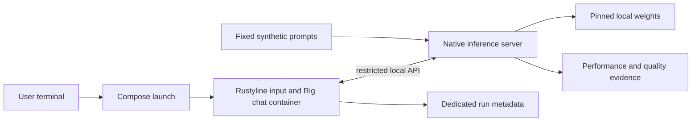

# Design

## Context

See [proposal](proposal.md) for the purpose and scope. The inspected baseline is master `3205f75e82ac7f1d82d9db961638252881cf7e88`: a TypeScript core, VS Code extension, Node tests, and a workflow that publishes VSIX releases. No Rust implementation exists. OpenSpec currently holds eight legacy capabilities. Project 8 is accessible, empty of active items, and already has the five agreed status options.

The target machine is Apple Silicon M3 Pro. Docker Desktop, Compose, and Model Runner were reachable during discovery; this proves installation only. No models, performance, containment, or PoC behavior have been validated.

## Goals / Non-Goals

**Goals:** isolate the experiment from daily work; make a reproducible local request; compare qualified configurations; offer minimal terminal chat; obtain human acceptance.

**Non-Goals:** tools, shell execution, repository editing, code-agent benchmarks, retrieval, persistent memory, model training, shared serving, installer product, OpenCode adapters, or legacy state migration. Individual testers run their own instance.

## Decisions

### D1. Four milestones with planning in M0

| Milestone | User value | Exit evidence |
|---|---|---|
| M0 Preparation and isolation | Start from a recoverable clean baseline and understand the next work | Approved reset, accepted environment boundaries, prerequisites, and all M1–M3 tickets with blockers |
| M1 Running a local model | Choose from measured local configurations | Repeatable request, memory qualification, performance and model-quality reports |
| M2 Creating the agent harness | Talk to the chosen model through a small Rust program | Rustyline input, Rig session routing, streaming, cancellation, errors, Compose launch |
| M3 User Acceptance Testing | Decide whether the PoC is useful enough to continue | Human checklist, linked defects, retest evidence, explicit approval or rejection |

M0 is a pairing checkpoint with the maintainer. Future tickets are placeholders with bounded outcomes, not permission to skip research dependencies. No old 20-ticket roadmap is imported.

### D2. Keep inference separate from the harness

Compose manages the harness container and declared model dependency. For Docker Model Runner on macOS, the inference engine executes natively under its documented sandbox, not inside the Linux container. Start with its llama.cpp backend only if the exact model and isolation checks pass. Keep the harness endpoint configurable so native Ollama, direct llama.cpp, or MLX can be evaluated without rewriting chat.



No Docker socket, host home, Git credentials, SSH agent, privileged mode, or host networking enters the harness. Start non-root with a read-only root filesystem and bounded temporary storage. Permit only the inference destination during chat. Ordinary Compose networks alone do not prove egress restriction. M0 demonstrates the proposed policy only on a surrogate container and synthetic endpoint. M1 qualifies the actual native server and client route before measurement, and M2 rechecks the final Compose harness before personal input. Requalify each changed runtime, route, or image. If native inference cannot meet the approved boundary, stop and bring a VM/dedicated-machine fallback to the maintainer before installation or measurement.

DMR's reachable API permits model management without authentication. Do not treat a Compose model binding as access authorization. Qualification must establish whether management routes and other host services are reachable; an inference-only mediation layer or an authenticated restricted server is required if the selected endpoint exceeds the approved permissions. Provisioning is a separate trusted operator action, with model hashes and download sizes reviewed first.

### D3. Rustyline input, plain streamed output, no tool loop

Use Rustyline for editable input and in-memory input history, and Rig for model requests plus session-local messages. Do not use a prebuilt coding-agent CLI whose default tools exceed this PoC. Build one small Rust binary with interactive and fixed-input modes. Do not build a full-screen Ratatui UI unless UAT identifies a concrete need.

Proposed interfaces are task input (message or messages, endpoint/model selection, bounded request settings), stream events (text, completion, incomplete, error), and run metadata (identity, timings, outcome). Keep prompt/response capture opt-in; fixed public benchmark prompts may be captured in their dedicated results directory. Never persist personal chat by default.

Only one in-flight request per session. Buffer/stream output while input editing is inactive; return control for the next prompt after completion or cancellation. Filter untrusted terminal escape sequences. Ctrl-C cancels the current response; Ctrl-D at the prompt exits. If the server cannot confirm cancellation, show that uncertainty and prevent overlapping inference in that session until reliable server-idle evidence or a controlled stop/restart of the serving process. Restarting only chat does not resolve server uncertainty. Freeze connection, first-response, stream-idle, and total-request deadlines in seconds. On deadline expiry, mark the response incomplete and apply the same cancellation/uncertainty rule. Only completed assistant replies enter later context; cancelled partial replies remain visibly incomplete and are excluded. No automatic retry. On context overflow, ask for a new session instead of silently truncating.

Illustrative invocation, implemented only in M2:
```sh
docker compose run --rm harness
docker compose run --rm harness --task /tasks/example.json
```
The fixed-input file must be explicitly mounted read-only from a dedicated input folder, not the repository or home. Use the Compose boundary for the first fixed-input Rig request, before adding Rustyline. Docker/TTY exit and cancellation behavior must be exercised using these actual launch paths. Output sanitization must handle escape sequences split across stream chunks. Context preflight must count the selected tokenizer/template, system messages and reserved output, or establish a conservative bound. Unsupported preflight makes the configuration ineligible for M2 until resolved.

### D4. Qualification before ranking

M0 inventories exact checkpoints for Qwen3.5-4B, FrogNano, Nanbeige, Nemotron Nano 4B, and MiniCPM. Names are research candidates, not verified compatibility promises. Record total loaded parameters, excluded vision weights, licenses, artifact provenance, and quantization. Smaller parameter classes are separate cohorts. Additional candidates require evidence and a bounded update to the inventory.

Proposed initial measurement defaults: concurrency one, 4-bit cohort where supported, 4K and 8K context workloads, fixed synthetic prompts, one cold start and five warm repetitions, and a 256-token output ceiling for timing only. Quality evaluation has a separately frozen output/reasoning budget and timeout sufficient for its tasks; never reuse the timing cap by accident. Freeze actual settings and task IDs before timed runs; report prompt token counts, cache state, first-token latency, generation tokens/sec, wall time, p50/range, and errors. Five runs are a pilot signal, not a statistical superiority claim. Record thermals/power mode and background activity. Define first-token and generation timing boundaries, cache reset, reasoning-token accounting, and exact input/output reservation for each context tier. A 4K qualification does not establish 8K support. Freeze candidate count and total experiment budget in M0. Fast is a measured comparison in M1; personal responsiveness is judged in M3, without an invented latency target.

Use strict decimal 8 GB as a proposed conservative interpretation. Measure peak physical serving allocations across model load, prefill, and generation, including GPU/unified memory without double-counting shared pages. RSS alone or weight file size is insufficient. Document swap and pressure; uncertain attribution cannot qualify a candidate. Use a documented conservative upper bound and error margin when exact attribution is unavailable; that upper bound must remain strictly below the limit. Build/evaluation resources are reported separately.

Compare the same GGUF artifact across compatible runtime configurations. MLX versus GGUF is a whole-stack comparison unless equivalence is established. Runtime selection includes a fixed-output sanity check: identical source weights do not ensure equal results across templates, precision, or decoding.

For model quality, use a pinned LiveCodeBench code-generation slice, with version/date range, prompts, output parsing, pass@1 policy, and predeclared execution limits. Execute generated code only in a disposable evaluator with no host mounts, credentials, network, or Docker socket. Bound total CPU, memory, process count, wall time, and output. The trusted launcher never executes generated code; dependencies are provisioned before the offline evaluator starts. Benchmark-generated code is not executed by the chat harness. Qualification of that evaluator is required before running model outputs. Public tasks do not establish absence of training contamination.

Qualify each candidate independently. Failure of the first baseline does not exclude the remaining approved inventory, and an incompatible runtime does not block model-quality evaluation on eligible configurations. Reports with one candidate are baselines, not comparative winners. If the bounded inventory is exhausted and no model qualifies, M1 records the failure and stops; it does not silently expand memory or change cohorts. No paid API reference is required for this PoC. A later reference run needs exact access, budget, data scope, and its own reviewed task. Closing a research issue after failure does not unlock M2: readiness requires a positive selection record and passing runtime/memory/evaluator evidence. M3 requires a qualified exact harness build. Rejection is a valid recorded outcome, not acceptance.

### D5. GitHub records follow OpenSpec

OpenSpec owns requirements and rationale; GitHub owns assignments, dependencies, and delivery status. Each issue brief contains description, value, short human verification steps with expected results, blockers, exclusions, and an OpenSpec link. Every triage issue/comment begins `> *This was generated by AI during triage.*`.

Four milestones group outcomes. User-story parents express features; child issues are single reviewable slices. Use native sub-issues and native blocked-by edges, never infer blockers from hierarchy. States: Backlog, Ready, In progress, In review, Done. Category is enhancement plus exactly one triage-state label. A ready label alone does not mean unblocked.

Draft views: milestone table, status board, and parent-issue table. Inspect existing automations before edits. Auto-add only the new PoC scope; archive history stays untouched. Auto-set new work to Backlog and closed work to Done. Reopened work returns to Backlog. Ready requires explicit blocker and brief checks. Review and UAT remain distinct. Avoid board-to-issue auto-close and parent completion inferred from a merged child PR.

After publication approval, bootstrap M0 tickets and provisional M1–M3 placeholders before cleanup or other implementation. Task 0.9 finalizes their content after research; it does not create its own prerequisite. Every implementation slice requires its real issue and an issue-linked branch.

Publication must be idempotent: keep a local draft-ID to issue-number map in the planning artifact after publication, inspect partial prior publication before retrying, and read back all records, relationships, and automation behavior. No token enters the PoC environment. This proposal authorizes no GitHub mutations.

## Risks / Trade-offs

- Native GPU process shares the Mac: require documented containment and negative access checks; containerization is not complete machine isolation.
- Benchmark code is executable: qualify an independent disposable evaluator before quality runs.
- Tool-free chat does not demonstrate coding agency: defer SWE-bench and agent improvements.
- Model/runtime compatibility can invalidate downstream details: preserve placeholders and revise their blockers rather than forcing a preferred stack.
- A cleanout can remove needed planning context: preserve a recovery ref and the current change; delete only an approved tracked manifest.
- Long model output can exceed context or alter a terminal: explicit bounds and inert rendering are required.

## Migration Plan

1. Verify clean state and a durable remote recovery reference at the exact pre-reset master SHA; verify that it can be checked out separately. Preserve existing archive refs too.
2. Generate the exact deletion list from tracked paths and show it with retained/revised paths. Untracked files, credentials, model caches, user databases, other worktrees, and remote issues/releases are not deletion targets.
3. Obtain manifest approval, then remove the old application and dependent CI/release jobs in one reviewable change on an issue-linked `codex/` branch. Preserve unrelated edits and leave the default branch untouched until review.
4. Retain `.agents/`, `AGENTS.md`, `docs/agents/`, OpenSpec config, archived history, and this proposal. Rewrite README and relevant navigation to describe the PoC. Update `.gitignore` for generated artifacts.
5. Apply the explicit spec retirement/replacement deltas at the normal approved sync/archive boundary. Until then, describe legacy main specs as pending replacement, not current proof of PoC behavior. Empty retired capabilities need explicit retirement notes/purpose updates at sync, without reviving old requirements.
6. Restore old source only by checking out the recovery reference separately. Never restore an old binary onto newly altered user state; this PoC performs no state migration.

### Reset inventory boundary

Candidate deletion groups: `apps/**`, `packages/**`, `test/**`, `scripts/**`, `config/**`, `.vscode/**`, `.nvmrc`, `package.json`, `package-lock.json`, `eslint.config.mjs`, `tsconfig*.json`, and obsolete files under `.audit/`. Review each `.github/` file separately; old VSIX build/release jobs must go, while useful generic metadata may remain. Review old product docs individually. These groups are a planning inventory, not permission to execute recursive deletion.

## Verification Plan

| Gate | Human action | Expected evidence |
|---|---|---|
| Recovery | Open the recovery revision in a separate checkout | Old tracked source is recoverable without altering personal state |
| Reset | Compare approved manifest with diff; inspect workflows | Only approved legacy paths removed; no VSIX publishing path remains |
| Isolation | Inspect mounts/user/network; probe synthetic denied paths and endpoints | Personal resources and unauthorized routes unavailable; failures block qualification |
| Inference | Start pinned model and repeat fixed prompts | Model identity, timings, complete failures, and memory accounting recorded |
| Quality | Run declared public cases in qualified evaluator | Pass/fail results with task IDs and bounded execution; no host side effects |
| Chat | Start Compose; send two turns; cancel; disconnect server; exceed context | Readable output, session context, explicit incomplete/error states, no silent retries |
| UAT | Repeat documented user checklist on pinned configuration | Findings linked to issues; acceptance recorded separately from measurements |
| GitHub | Open views and traverse parents/blockers; exercise approved transitions | Correct relationships and statuses without premature acceptance |

New automated tests or standalone verifiers require explicit authorization under project instructions. The plan specifies observable checks; routine command failures use their own exit status. Identify the incorrect outcome each proposed behavioral test would catch before requesting authorship scope.

## Arena synthesis

Two independent revisions reviewed all artifacts. The parent and independent cross-judge selected B as the base for staged isolation qualification, per-candidate eligibility, explicit deadlines, and complete issue briefs. The judge scored A 21.5/25 and B 23/25 across scope, safety, evaluation, issue structure, and verifiability; these are review judgments, not product measurements.

Grafts from A: require positive evidence before advancing milestones, qualify the first Rig request inside Compose, and separate timing from quality budgets. Both candidates found the publication-order flaw; bootstrap records now precede implementation. Rejected A's suggestion to weaken board views/automation because the user explicitly requested them. Neither candidate dropped out. Detailed scratch reviews were kept outside the repository; this section is the durable synthesis.

No unresolved reviewer disagreement requires changing the agreed PoC scope. M0 still owns research choices and paired approval. If containment fails, proposing a VM/dedicated machine or changing limits requires a new maintainer decision. This review does not establish runtime compatibility, security, speed, or usability.

## Open Questions

Exact runtime/checkpoint versions, feasible shared quantization, benchmark case IDs, and measurement commands are M0 research outputs. They may change adapter details but cannot relax isolation, memory eligibility, local-only behavior, or human acceptance. Any required relaxation returns to the maintainer.


## Draft deletion manifest

This manifest contains 149 tracked paths at the inspected baseline. It is for review, not approved deletion. Refresh it against the current base and unrelated work before cleanup. Retain Git history, archived OpenSpec records, agent configuration and this change. Rewrite README, docs/workflow.md and .gitignore separately; do not delete the whole checkout. Historical design prose remains recoverable from the verified source reference.

<details>
<summary>Exact candidate deletion paths</summary>

```text
.audit/backlog-decisions.tsv
.github/designs/64/empty.svg
.github/designs/64/prototype.html
.github/designs/64/review.svg
.github/designs/64/saved.svg
.github/workflows/ci.yml
.nvmrc
.vscode/launch.json
.vscode/settings.json
.vscode/tasks.json
apps/vscode/README.md
apps/vscode/esbuild.mjs
apps/vscode/esbuild.test.mjs
apps/vscode/native/README.md
apps/vscode/native/scoped-publication.py
apps/vscode/native/test-scoped-publication.py
apps/vscode/package.json
apps/vscode/scripts/package.mjs
apps/vscode/scripts/test-package.mjs
apps/vscode/src/candidate-check-runner.ts
apps/vscode/src/candidate-journal.ts
apps/vscode/src/candidate-workspace.ts
apps/vscode/src/codex-account-context.ts
apps/vscode/src/codex-conversation-client.ts
apps/vscode/src/conversation-controller.ts
apps/vscode/src/coordination-actions.ts
apps/vscode/src/coordination-controller.ts
apps/vscode/src/coordination-ui.ts
apps/vscode/src/coordination-view.ts
apps/vscode/src/detail-document.ts
apps/vscode/src/diagnostic-bundle.ts
apps/vscode/src/diagnostic-commands.ts
apps/vscode/src/execution-actions.ts
apps/vscode/src/execution-coordinator.ts
apps/vscode/src/execution-ui.ts
apps/vscode/src/execution-view.ts
apps/vscode/src/extension.ts
apps/vscode/src/file-context.ts
apps/vscode/src/goal-interpreter.ts
apps/vscode/src/knowledge-controller.ts
apps/vscode/src/project-retrieval.ts
apps/vscode/src/recovery-files.ts
apps/vscode/src/recovery-ui.ts
apps/vscode/src/reflection-controller.ts
apps/vscode/src/repository-root.ts
apps/vscode/src/scoped-publication.ts
apps/vscode/src/source-sharing.ts
apps/vscode/src/sqlite-project-repository.ts
apps/vscode/src/storage-boundary.ts
apps/vscode/src/technical-lookup.ts
apps/vscode/src/work-view.ts
apps/vscode/src/workspace-draft.ts
apps/vscode/src/workspace-integration.ts
apps/vscode/src/workspace-path.ts
apps/vscode/src/workspace-shell.ts
apps/vscode/test/fixtures/fake-codex-account-context.mjs
apps/vscode/test/fixtures/fake-codex-conversation.mjs
apps/vscode/test/profile-settings.mjs
apps/vscode/test/run.mjs
apps/vscode/test/suite/activation.test.ts
apps/vscode/test/suite/agent-workspace.test.ts
apps/vscode/test/suite/candidate-check-runner.test.ts
apps/vscode/test/suite/candidate-journal.test.ts
apps/vscode/test/suite/candidate-workspace.test.ts
apps/vscode/test/suite/codex-account-context.test.ts
apps/vscode/test/suite/codex-conversation.test.ts
apps/vscode/test/suite/context.test.ts
apps/vscode/test/suite/conversation-controller.test.ts
apps/vscode/test/suite/coordination-workspace.test.ts
apps/vscode/test/suite/coordination.test.ts
apps/vscode/test/suite/costs.test.ts
apps/vscode/test/suite/detail-host-fixture.ts
apps/vscode/test/suite/detail-identity.test.ts
apps/vscode/test/suite/diagnostic-bundle.test.ts
apps/vscode/test/suite/execution-coordinator.test.ts
apps/vscode/test/suite/execution-forecast.test.ts
apps/vscode/test/suite/execution-patch.test.ts
apps/vscode/test/suite/execution-state.test.ts
apps/vscode/test/suite/execution-view.test.ts
apps/vscode/test/suite/file-context-render.test.ts
apps/vscode/test/suite/file-context.test.ts
apps/vscode/test/suite/forecast-fixture.ts
apps/vscode/test/suite/foundations.test.ts
apps/vscode/test/suite/index.ts
apps/vscode/test/suite/knowledge.test.ts
apps/vscode/test/suite/project-lifetime-vscode.ts
apps/vscode/test/suite/project-lifetime.test.ts
apps/vscode/test/suite/project-retrieval.test.ts
apps/vscode/test/suite/project.test.ts
apps/vscode/test/suite/proposal.test.ts
apps/vscode/test/suite/provider-settings.test.ts
apps/vscode/test/suite/recovery-host.test.ts
apps/vscode/test/suite/recovery.test.ts
apps/vscode/test/suite/reflection.test.ts
apps/vscode/test/suite/result-review-fixture.ts
apps/vscode/test/suite/result-review-vscode.ts
apps/vscode/test/suite/result-review.test.ts
apps/vscode/test/suite/resumption-view.test.ts
apps/vscode/test/suite/resumption.test.ts
apps/vscode/test/suite/scoped-publication.test.ts
apps/vscode/test/suite/untrusted.test.ts
apps/vscode/test/suite/workspace-integration.test.ts
apps/vscode/test/suite/workspace.test.ts
apps/vscode/tsconfig.json
config/vscode-version.mjs
docs/USER_DESIGN_PRINCIPLE.md
docs/overview.md
docs/research/2026-11-07-shared-project-truth.md
eslint.config.mjs
package-lock.json
package.json
packages/core/package.json
packages/core/src/context.ts
packages/core/src/contracts.ts
packages/core/src/conversation.ts
packages/core/src/coordination-contracts.ts
packages/core/src/coordination.ts
packages/core/src/costs.ts
packages/core/src/execution-contracts.ts
packages/core/src/execution-forecast.ts
packages/core/src/execution-patch.ts
packages/core/src/execution.ts
packages/core/src/index.ts
packages/core/src/inspection.ts
packages/core/src/knowledge.ts
packages/core/src/provider-account-context.ts
packages/core/src/recovery.ts
packages/core/src/reflection.ts
packages/core/src/resumption.ts
packages/core/src/supplied-source.ts
packages/core/tsconfig.json
scripts/accept-candidate.mjs
scripts/candidate-profile.mjs
scripts/documentation-sources.mjs
scripts/evaluate-project-retrieval.mjs
scripts/package-candidate.mjs
scripts/release-package.mjs
test/acceptance/catalog.json
test/acceptance/principles.json
test/acceptance/retrieval-fixture.json
test/candidate-profile.test.mjs
test/diagnostic-commands.test.mjs
test/documentation-sources.test.mjs
test/editor-boundary.test.mjs
test/release-package.test.mjs
test/repository-root.test.mjs
test/scaffold-contract.test.mjs
tsconfig.base.json
tsconfig.json
```

</details>

## Research references

- [Docker Model Runner execution and API exposure](https://docs.docker.com/ai/model-runner/)
- [Compose model lifecycle](https://docs.docker.com/ai/compose/models-and-compose/)
- [Ollama platform behavior](https://docs.ollama.com/faq)
- [Rig](https://github.com/0xPlaygrounds/rig) and [Rustyline](https://docs.rs/rustyline/latest/rustyline/)
- [LiveCodeBench](https://livecodebench.github.io/)

These references support research choices; they do not establish local qualification.
